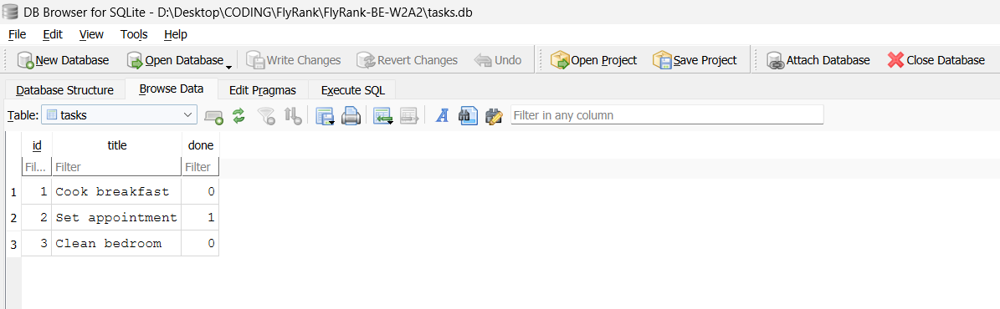
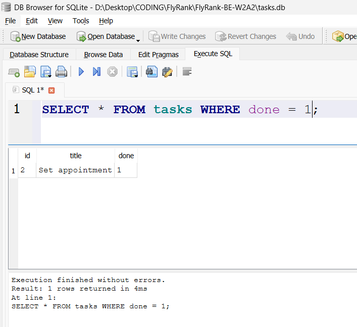

# FlyRank-BE-W3A2
Adding Database to CRUD API Assignment for FlyRank Backend Internship

This repo contains a sample CRUD API for a to-do list where a user can view, create, update, or delete a task, with the addition of using SQLite as a database.

## Installation Instructions

1. **Clone the repository**
   ```bash
   git clone <repo-url>
   ```

2. **Navigate to the project folder**
   ```bash
   cd FlyRank-BE-W3A2
   ```

3. **Install dependencies**
   ```bash
   npm i
   ```

4. **Start the server**
   ```bash
   node server.js
   ```

5. **Open in browser**
   - App: http://localhost:3000
   - Swagger UI: http://localhost:3000/docs

## Table of Endpoints

| Method | Path | Summary | Success | Errors |
|--------|------|---------|---------|--------|
| GET | `/tasks` | Returns list of tasks | 200 | — |
| POST | `/tasks` | Creates a new task | 201 | — |
| GET | `/health` | Returns server status | 200 | — |
| GET | `/tasks/{id}` | Returns task by id | 200 | — |
| PUT | `/tasks/{id}` | Update existing task | 200 | 400, 404 |
| DELETE | `/tasks/{id}` | Delete task by id | 204 | 404 |

## Why SQLite?
SQLite was chosen because it provides a database packaged alongside the application. It allows data to be stored to a file, so that data does not get cleared whenever the server restarts.

The data lives in a file called tasks.db, which is created automatically if it does not exist yet. Since the creation of the .db files are usually included in the code, these files are also usually added to the .gitignore file.

## Screenshots

### DB Browser Preview


### Sample Query
